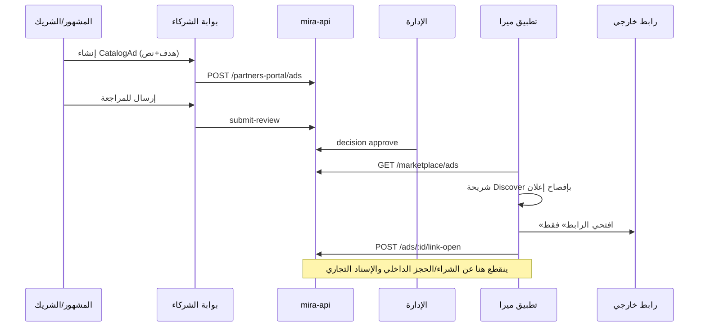

# 02 — مسارا الشراء والحجز ونقاط انقطاع الدليل

مرجع الإسناد التجاري: [04-attribution-rules.md](./04-attribution-rules.md).

## مخطط عام (الوضع اليوم)

## مسار أ — شراء الكريم عبر إعلان مشهور

| الخطوة | المطلوب للمنتج | الموجود اليوم | دليل |
|---|---|---|---|
| 1. تسجيل مشهور ومنح صلاحية | هوية/دور معلن | أي `Partner` نشط + `PartnerUser`؛ لا دور celebrity | `schema.prisma` Partner؛ حارس `PartnerTokenGuard` |
| 2. ربط عرض شريك آخر | إعلان → منتج أصلي | `create` يربط `targetKind/targetId` إن الهدف منشورًا أو ملكًا للمعلن | `assertTargetLinkable` |
| 3. رفع وسائط الإعلان ونشره | وسائط تجربة المشهورة | **لا رفع لإعلان**؛ عند النشر تُعرض وسائط المنتج الأصلي | `publishedMedia(target…)` |
| 4. الدخول من ميرا أو رابط اجتماعي | صفحة/رابط إعلان | قائمة عامة `/marketplace/ads` داخل Discover؛ **لا** صفحة مشهور عامة ولا مخطط deep link مثبت للإعلان | بحث `lib/`؛ لا `mira://ad` |
| 5. الشراء | سلة COD أو دفع مع `adId` على البند | إن وُجد `advertisement` يستدعي `_openAdLink` ويعود — **لا** `addToCart` | `discover_presentation_screen.dart` L1153–1162 |
| 6. تعديل/إلغاء/استرجاع | على مستوى البند مع الإسناد | طلبات COD موجودة للمنتجات المباشرة؛ بلا `adId`؛ إرجاع جزئي غير مُعرَّف كنموذج إسناد | `CommerceOrderItem` بلا حقول إعلان |
| 7. ظهور في تقريري الطرفين | مشهور + تاجر من مصدر واحد | إحصاء الشريك = `linkOpens` فقط؛ لا مشترين/قطع | `stats` |

### أول نقطة ينقطع عندها الدليل (مسار أ)

**الخطوة 3 ثم تتأكد في 5:** لا وسائط إعلان مستقلة، ثم مسار الشراء من شريحة الإعلان لا يدخل السلة الداخلية أصلًا. حتى لو أُضيف المنتج للسلة من مسار غير إعلاني، لا يُحفظ أي مرجع إعلان على البند.

## مسار ب — حجز خدمة صالون عبر إعلان

| الخطوة | المطلوب | الموجود | دليل |
|---|---|---|---|
| 1–2. مشهور + ربط خدمة | كما أعلاه لـ `service` | مدعوم في إنشاء الإعلان والاختبارات | `catalog-ad.ph4.rc2` خدمة |
| 3. وسائط إعلان | مستقلة | غائبة (وسائط الخدمة الأصلية) | نفس `publishedMedia` |
| 4. الدخول | Discover / رابط | شريحة خدمة من إعلان تُبنى إن البائع `clinic|salon` | `discover_published_ad.dart` L46–76 |
| 5. الحجز | بدء حجز من الإعلان مع `adId` | `appointmentOperational: false` ثابت في العقد العام؛ واجهة Discover تشترطها لإظهار طلب الموعد | `catalog-ad.service.ts` L265–267؛ الشاشة L1086–1087 |
| 6. تأكيد/إلغاء | أحداث الحجز | `CommerceBooking` قائم بلا `adId` | schema |
| 7. تقارير الطرفين | حجوزات مؤكدة/ملغاة منسوبة | غائب | — |

### أول نقطة ينقطع عندها الدليل (مسار ب)

**الخطوة 5:** العقد العام يعطّل التشغيل المواعيدي للإعلان (`appointmentOperational: false`)، فلا يُفتح مسار الحجز التشغيلي من شريحة الإعلان.

## ماذا يعمل من البداية إلى النهاية اليوم؟

رحلة **إعلان → مراجعة → ظهور في الخلاصة → فتح رابط خارجي → تسجيل `link_open`** قابلة للإكمال في الكود ومغطاة باختبارات وحدة/HTTP موجودة (HTTP لم تُشغَّل في هذه الجلسة لعدم توفر DB).

رحلة **إعلان → شراء داخلي منسوب** أو **إعلان → حجز منسوب → تقارير مشتركة** غير موجودة كمسار متصل.
