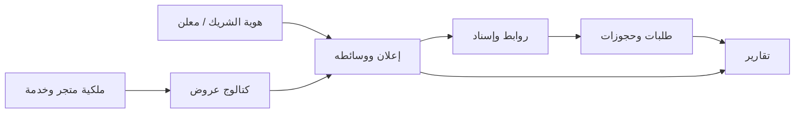

# 05 — الهيكل والعقود وخريطة المطوّر

## 1. حدود المسؤوليات (باك اند)



| حد | يبقى في نطاق قائم | وحدة/امتداد جديد |
|---|---|---|
| هوية المعلن | `Partner` + `PartnerUser` | اختياريًا علامة/قدرة `canPublishAds` دون نوع حساب منفصل ما لم يقرر المالك |
| ملكية العرض | `Product`/`Service.partnerId` | — |
| كتالوج | `marketplace` + بوابة محتوى | — |
| إعلان | `CatalogAd` + مراجعة | **وسائط `ownerKind=ad`**؛ إذن ربط إن لزم |
| روابط/إسناد | `CatalogAdAction` اليوم | **إسناد بنود** على cart/order/booking وفق [04](./04-attribution-rules.md) |
| تجارة | `commerce.service` | قبول `adId` والتحقق الخادمي |
| تقارير | `stats` الضحل | قراءات فوق حقائق البنود |

لا تُفرض خدمات مصغّرة مستقلة؛ التوسع داخل `mira-api` modules الحالية كافٍ بالأدلة الحالية.

## 2. شجرة مسارات مستهدفة (نمط المشروع)

| المسار | المسؤولية | يعتمد على | يعاد استخدامه | يُمنع تكراره |
|---|---|---|---|---|
| `POST/GET/PATCH /partners-portal/ads` | دورة حياة الإعلان | Partner auth، هدف منشور | القائم | منطق سعر/مخزون |
| `POST .../ads/:id/media*` | وسائط الإعلان | تخزين كتالوج | `CatalogContentService` patterns | رفع يكتب على منتج التاجر |
| `GET /marketplace/ads` و `/:id` | عقد عام للخلاصة/الرابط | أهلية الأطراف | القائم | إرجاع سعر مخزّن في الإعلان |
| `POST .../link-open` | نقرات | idempotent eventId | القائم | اعتباره شراءً |
| `POST /commerce/cart/items` (+`adId`) | إضافة بند منسوب | تحقق الإعلان | commerce | دمج مصادر مختلفة في صف واحد دون مصادر |
| `POST /commerce/bookings` (+`adId`) | حجز منسوب | تحقق | commerce | — |
| `GET /partners-portal/ads/:id/insights` | تقرير مشهور | حقائق البنود | — | عدّادات منفصلة غير قابلة لإعادة البناء |
| `GET /partners-portal/offers/:id/attribution` | تقرير تاجر | نفس الحقائق | — | قراءة مبيعات شريك آخر |

## 3. نموذج العلاقات المقترح

```
Partner 1──* CatalogAd (advertiser)
Partner 1──* CatalogAd (publisher)
CatalogAd *──1 Product|Service (target)
CatalogAd 1──* CatalogMedia (ownerKind='ad')   // جديد
CatalogAd 1──* CatalogAdAction
CommerceCartItem adId? → CatalogAd             // جديد
CommerceOrderItem adId? → CatalogAd            // جديد
CommerceBooking adId? → CatalogAd              // جديد
```

**فهارس حرجة:** `(publisher_partner_id, created_at)` على الحقائق؛ `(ad_id, status)`؛ `(seller_partner_id, ad_id)`؛ استمرار فهارس الهدف الحالية على `catalog_ads`.

### حالات

| كيان | حالات |
|---|---|
| إعلان | `draft → in_review → published \| rejected`؛ `withdrawn`؛ تعديل بعد نشر وفق السياسة الحالية (مقفل غالبًا) |
| وسائط إعلان | `draft/published/pending_removal` كما الكتالوج |
| عملية | كما `CommerceOrder` / `CommerceBooking` |

**من يجيز إعلان عرض الغير؟** اليوم: أهلية الهدف المنشور + مراجعة إدارة. **مقترح قرار:** إذن تاجر اختياري (DEC).  
**إيقاف:** سحب المعلن، قرار إدارة، تعليق شريك، نفاد/تعطيل هدف → الإعلان يختفي من العام ويبقى التاريخ.  
**عزل:** التحقق من الشريك على كل قراءة تقرير؛ منع `partnerA` من `insights` لـ `partnerB`.

## 4. عقود حساسة — أمثلة

### إنشاء إعلان (قائم)

```http
POST /api/v1/partners-portal/ads
{ "targetKind": "product", "targetId": "…", "captionAr": "جرّبت الكريم" }
```

رفض إن وُجد `priceHalalas`.

### إضافة للسلة مع إسناد (مقترح)

```http
POST /api/v1/commerce/cart/items
{ "productId": "…", "quantity": 1, "variantKey": "", "adId": "…" }
```

استجابة البند تتضمن `adId` إن قُبل. رفض إن الإعلان لا يطابق المنتج أو غير منشور.

### عقد عام إعلان (قائم مختصر)

يشمل `id`, `disclosure`, `captionAr`, `advertiser`, `publisher`, `seller`, `target`, `media[]`, `actions.openLink|appointmentOperational|…`.

**مطلوب لاحقًا:** `media[]` من مالك الإعلان؛ `actions` تعكس شراء داخلي/حجزًا حقيقيين عند التوفر.

## 5. التطبيق والويب — ماذا يُعاد استخدامه

| مكوّن | المسار التقريبي | دور في المشاهير |
|---|---|---|
| مشغّل Discover | `discover_presentation_screen.dart` | عرض شريحة الإعلان |
| دوائر إجراءات | نفس الشاشة + chrome | شراء/حجز/متجر/مقدّم |
| متجر / مقدّم | `PartnerDetailScreen` + `PartnerCatalogSurface` | من نوع الهدف لا من اسم الشريك |
| تفاصيل/سلة/حجز | `product_detail_screen`, commerce clients | تمرير `adId` |
| دخول | جلسة Firebase/ضيف | الحفاظ على سياق الرابط |
| بوابة إعلانات | `partners-portal/.../ads.js` | توسيع محرر الوسائط والنتائج |
| إدارة | `admin-portal` مراجعة إعلانات | الإبقاء + فروق الإذن |

**قواعد UX مطلوبة:** اسم المشهور → صفحته؛ المتجر/مقدّم الخدمة → جهة التنفيذ؛ الشراء/الحجز يتبعان حالة العرض (`للعرض فقط` إن لزم)؛ الحفاظ على موضع التصفح عند الرجوع (قائم جزئيًا في Discover).

نموذج إعلان المشهور ≠ نموذج منتج، مع مشاركة عارض الوسائط والمشغّل.

## 6. خريطة الأسطح

| سطح | عام/خاص | المحتوى |
|---|---|---|
| صفحة المشهور العامة | عام | كل إعلاناته المنشورة؛ متجره/خدماته إن وُجدت كمالك عرض |
| مساحة المشهور في التطبيق/البوابة | خاص | إدارة إعلانات، روابط، نتائج مصرّح بها |
| مساحة التاجر/المركز | خاص | نتائج عروضه حسب مشهور/مقطع |
| الإدارة | خاص | مراجعة، سحب، فض تعارضات |

أرقام المبيعات للجمهور: **لا** ما لم يُقرَّر صراحة ([04](./04-attribution-rules.md) قرارات).  
التوسعة داخل البوابة القائمة قبل موقع منفصل.

## 7. للمطوّر الجديد — أين أغيّر ماذا؟

| مثال | نقطة الدخول | الموديول | العقد | اختبار يحمي السلوك |
|---|---|---|---|---|
| تعديل حد مدة/حجم الفيديو | `catalog-content.policy.ts` + نص البوابة | `catalog-content` | أخطاء الرفع | `catalog-video-duration.schema-tests.ts`؛ RC محتوى |
| إضافة فئة عرض | تصنيف الكتالوج / فلاتر Discover | marketplace taxonomy | كتالوج عام | اختبارات فلاتر قائمة |
| تغيير قاعدة الإسناد | [04](./04-attribution-rules.md) ثم `commerce.service` + مخطط البنود | commerce + ads | cart/booking | اختبارات تجارة جديدة: بندان بنفس المنتج ومصدرين |
| مؤشر جديد للوحة | تجميع فوق حقائق البنود | تقرير شريك | insights API | اختبار تجميع على فيxture طلب مختلط |

### تشغيل محلي وأوامر تحقق موجودة

```bash
# من جذر المستودع
flutter test test/features/marketplace/discover_ad_feed_test.dart \
  test/features/marketplace/discover_ad_rc7_test.dart

cd mira-api
npx tsx src/marketplace/catalog-video-duration.schema-tests.ts
# اختبارات HTTP للإعلان (تتطلب DB + خادم — انظر ملفات catalog-ad.ph4*.ts)
```

لا تُخترع أوامر غير موجودة في `package.json`/`README` دون التحقق.
